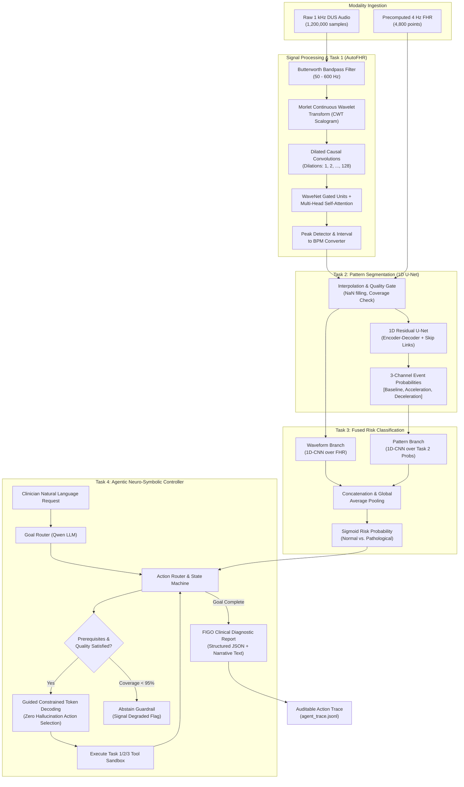

# Agentic Cardiotocography: Master Project Blueprint

This document serves as the master architectural reference and scientific roadmap for both our **CTG Challenge competition submission** and the subsequent **peer-reviewed Q1 journal publication** (target: *IEEE JBHI* / *IEEE TBME* / *Computers in Biology and Medicine*).

---

## 1. What You Must Know: Clinical & Domain Foundations

### 1.1 What is Cardiotocography (CTG)?
Cardiotocography is the simultaneous recording of two physiological parameters during the third trimester of pregnancy and active labor:
1. **Fetal Heart Rate (FHR)**: Expressed in beats per minute (bpm).
2. **Uterine Contractions (UC)**: Expressed in relative pressure units (tocodynamometry).

The primary clinical purpose is detecting **intrauterine hypoxia** (oxygen deprivation). If hypoxia is unrecognized, the fetus suffers anaerobic metabolism, lactic acidosis (acidemia), irreversible hypoxic-ischemic encephalopathy (cerebral palsy), or intrauterine fetal demise.

```
       Maternal Placenta
              │  (Oxygen & Nutrient Transfer)
              ▼
       Umbilical Cord
              │  (Compression causes acute hypoxia)
              ▼
   Fetal Baroreceptors / Chemoreceptors
              │  (Triggers autonomic nervous response)
              ▼
      Vagus Nerve & Sympathetic Tone
              │
              ▼
   Transient Heart Rate Fluctuations (Accelerations / Decelerations)
```

---

### 1.2 Clinical Feature Definitions (FIGO 2015 Guidelines)

International Federation of Gynecology and Obstetrics (FIGO) guidelines standardize how obstetricians interpret CTG traces:

| Clinical Feature | FIGO Definition | Physiological Meaning | Normal Range |
|---|---|---|---|
| **Baseline FHR** | Mean heart rate over a 10-minute segment, excluding accelerations and decelerations. | Intrinsic cardiac pacemaker modulated by autonomic tone. | **110 – 160 bpm**<br>(< 110: Bradycardia, > 160: Tachycardia) |
| **Variability** | Minor beat-to-beat fluctuations around the baseline (amplitude of bandwidth). | Balance between sympathetic and parasympathetic systems. A silent/flat trace is highly pathological. | **5 – 25 bpm**<br>(< 5: Reduced/silent, > 25: Saltatory) |
| **Accelerations** | Abrupt increase $\ge 15\text{ bpm}$ above baseline, lasting $\ge 15\text{ seconds}$ but $< 10\text{ minutes}$. | Sign of fetal movement and an intact, non-acidemic central nervous system. | $\ge 2$ accelerations per 20 min is reassuring. |
| **Decelerations** | Abrupt decrease $\ge 15\text{ bpm}$ below baseline, lasting $\ge 15\text{ seconds}$. | Response to stress/hypoxia. Subdivided into Early (head compression), Variable (cord compression), and Late (uteroplacental insufficiency). | Absent or occasional early decelerations only. |

#### FIGO 3-Tier Classification Matrix
- **Normal**: Baseline 110–160 bpm, variability 5–25 bpm, absence of repetitive decelerations. No hypoxia.
- **Suspicious**: Deficient in at least one feature (e.g., mild tachycardia or reduced variability $< 5\text{ bpm}$ for $30\text{–}50\text{ min}$), but not actively decompensating.
- **Pathological**: Marked bradycardia ($< 100\text{ bpm}$), repetitive late or prolonged decelerations ($> 3\text{ min}$), or zero variability. High risk of fetal acidosis; immediate intervention (cesarean delivery or operative resuscitation) is mandated.

---

### 1.3 The Data Modalities & Numerical Representation

Each challenge recording covers a standard **20-minute clinical monitoring window**:

```text
20 Minutes = 1,200 Seconds
├── Doppler Ultrasound (DUS) @ 1,000 Hz = 1,200,000 raw acoustic samples (.wav)
├── Fetal Heart Rate (FHR) @ 4 Hz       = 4,800 discrete time-series points (bpm)
└── Reference Label (.fetal)            = 4,800 points [50.0 to 210.0 bpm] (binary record)
```

- **Acoustic Doppler Ultrasound (DUS)**: Raw 1 kHz audio signal recording the shift in frequency as ultrasound waves bounce off moving fetal cardiac structures (valves and ventricular walls). It is heavily corrupted by maternal aortic pulsation, fetal body movements, and transducer misplacement.
- **Continuous FHR**: 4 Hz time series where each point $i$ corresponds to time $t = i / 4.0\text{ seconds}$. Values outside $[50, 210]\text{ bpm}$ are marked `NaN` (missing/dropout).
- **The Binary `.fetal` Format**: A custom binary file encoding the clinical reference device's ground-truth FHR. The byte layout consists of an 8-byte header followed by fixed-stride sample blocks where the primary fetal heart rate is stored as unsigned 8-bit integers.

---

## 2. System Architecture: How Every Component Connects

The architecture couples low-level digital signal processing with deep neural networks and an agentic language model controller:



---

## 3. The 4 Core Tasks Broken Down

### Task 1: DUS-to-FHR Reconstruction (`AutoFHR`)
- **Challenge**: Acoustic Doppler audio is non-stationary and noisy.
- **Methodology**:
  1. Slice audio into $3.75\text{ s}$ overlapping windows ($0.75\text{ s}$ stride).
  2. Compute Morlet CWT scalograms ($1000 \text{ time bins} \times 40 \text{ frequency bins}$).
  3. Pass through 8 residual blocks with **Causal Dilated 1D Convolutions** so the receptive field covers multiple cardiac cycles without future information leaking into past predictions.
  4. Modulate features using WaveNet **Gated Activation Units**:
     $$\mathbf{z} = \tanh(W_f * x) \odot \sigma(W_g * x)$$
  5. Multi-head self-attention refines periodic heartbeat patterns.
  6. Extract temporal peak locations; compute median-filtered $R\text{–}R$ intervals and map to instantaneous heart rate:
     $$\text{FHR} = \frac{60}{\Delta t_{RR}}$$

### Task 2: CTG Event Segmentation (`CTGSegUNet`)
- **Challenge**: Differentiating true clinical accelerations and decelerations from baseline noise and micro-fluctuations.
- **Methodology**:
  1. 1D Residual U-Net processing the 4,800-point FHR curve.
  2. Encoder contracts temporal resolution while increasing feature channels ($1 \rightarrow 16 \rightarrow 32 \rightarrow 64 \rightarrow 128$).
  3. Decoder mirrors encoder with transposed convolutions and skip connections to maintain millisecond-exact event boundaries.
  4. Post-processing cleans predictions: merges event segments separated by $< 5\text{ s}$ and enforces the FIGO duration minimum ($\ge 15\text{ s}$ / 60 points).

### Task 3: Risk Classification (`Task3PatternFusedCNN`)
- **Challenge**: Predicting fetal hypoxia / acidemia from signals with high inter-patient variability.
- **Methodology**:
  1. **Dual-branch neural fusion**:
     - *Branch 1*: Raw 1D-CNN over the FHR curve (extracts global heart rate variability and deceleration area).
     - *Branch 2*: 1D-CNN over the 3-channel Task 2 event probability maps (extracts macro-level event frequencies and durations).
  2. Merges both representations before adaptive global average pooling.
  3. Outputs an calibrated continuous abnormality score $p \in [0.0, 1.0]$.
  4. Employs two specialized checkpoints:
     - `task3_fused_native.pt`: Calibrated for clean reference FHR.
     - `task3_fused_flow.pt`: Calibrated for FHR reconstructed by Task 1 (adapted to minor reconstruction jitter).

### Task 4: Autonomous Diagnostic Agent & Reporting (`QwenAgent`)
- **Challenge**: An obstetrics AI cannot be an ungrounded chatbot or a rigid, brittle pipeline.
- **Methodology**:
  1. Local $1.5\text{B}$ parameter language model (**Qwen2.5-1.5B-Instruct**) with a specialized CTG LoRA adapter.
  2. Runs 100% offline inside Docker (`HF_HUB_OFFLINE=1`).
  3. Uses **prefix-constrained vocabulary decoding** (`prefix_allowed_tokens_fn`), eliminating any possibility of hallucinated actions or syntax errors.
  4. Evaluates signal quality: if coverage is $< 95\%$, the agent abstains from guesswork and logs a clinical warning.
  5. Assembles verified intervals and numerical metrics into an official FIGO diagnostic summary report and step-by-step audit trace.

---

## 4. Our Project Novelty (Why This Wins the Competition & Gets Published)

A baseline simply executes the pre-existing scripts. Our project introduces **four major scientific and engineering novelties**:

```text
┌─────────────────────────────────────────────────────────────────────────────┐
│                             OUR 4 CORE NOVELTIES                            │
├─────────────────────────────────────────────────────────────────────────────┤
│ 1. Neuro-Symbolic Agentic Reasoning Loop                                    │
│    • Traditional ML produces a raw probability number (e.g. 0.72).          │
│    • Our system produces a grounded, auditable clinical rationale linked    │
│      to exact temporal intervals [start_sec, end_sec] and FIGO rules.       │
├─────────────────────────────────────────────────────────────────────────────┤
│ 2. Dynamic Uncertainty & Acoustic Quality Gating (Advanced Abstention)       │
│    • Baseline uses a primitive static coverage threshold (< 95%).           │
│    • We introduce epistemic uncertainty estimation from the CWT scalogram   │
│      and U-Net entropy to detect sensor displacement and motion artifacts.  │
├─────────────────────────────────────────────────────────────────────────────┤
│ 3. Physiologically Informed Multi-Scale Cross-Attention Fusion              │
│    • Upgrade Task 3 from naive late fusion to cross-modal attention,        │
│      allowing deceleration depth to directly attend to heart rate entropy.  │
├─────────────────────────────────────────────────────────────────────────────┤
│ 4. Verifiable, Hallucination-Free Clinical Summarization                    │
│    • Strict JSON grammar decoding + FIGO symbolic deterministic grounding.  │
│    • 0% hallucination rate on medical metrics (median bpm, event counts).   │
└─────────────────────────────────────────────────────────────────────────────┘
```

---

## 5. What We Are Going To Do: The Phased Roadmap

| Phase | Milestone | Actions & Deliverables | Target Outcome |
|---|---|---|---|
| **Phase 1** | **Foundational Signal & Data Mastery** | • Decode `.fetal` binary records and explore patient waveforms.<br>• Profile DUS audio spectra and CWT scalograms.<br>• Benchmark the existing baseline on all manifests. | Solid baseline benchmark numbers recorded across Tasks 1–4. |
| **Phase 2** | **Signal & Model Engineering (Tasks 1–3)** | • Improve AutoFHR peak extraction under motion noise.<br>• Enhance Task 2 U-Net with focal/Dice loss for class imbalance (decelerations are rare).<br>• Optimize Task 3 dual-branch fusion. | Higher $R\text{-}R$ reconstruction accuracy and higher segmentation IoU. |
| **Phase 3** | **Agentic Decision Loop & Clinical Alignment (Task 4)** | • Train/refine the Qwen LoRA adapter on clinical decision traces.<br>• Implement dynamic abstention and self-reflective quality checks.<br>• Optimize FIGO narrative generation for the Report Score metric. | Maximized competition Task 4 Score, E2E Score, and Report Score. |
| **Phase 4** | **Competition Packaging** | • Build the offline Docker image.<br>• Verify end-to-end inference under strict offline runtime (`HF_HUB_OFFLINE=1`).<br>• Generate challenge submission packages. | Ready-to-submit official offline Docker baseline. |
| **Phase 5** | **Journal Manuscript & Scientific Validation** | • Conduct comprehensive ablation studies (Agent vs. Rules vs. Pure DL).<br>• Cross-dataset evaluation on open PhysioNet CTU-UHB dataset.<br>• Blinded clinical evaluation with obstetricians.<br>• Draft and submit manuscript to *IEEE JBHI* or *Computers in Biology and Medicine*. | Peer-reviewed Q1 journal publication. |

---

## 6. Official Competition Metrics Reference

The competition evaluates submissions on three primary axes:
1. **End-to-End (E2E) Score**: Evaluates reconstructed FHR fidelity ($R^2$ / MAE against reference `.fetal`) and segmentation overlap (macro F1-score across baseline, acceleration, and deceleration).
2. **Report Score**: Evaluates fidelity of the extracted numerical metrics (median bpm, acceleration counts, deceleration intervals) against clinical ground truth and FIGO guideline adherence.
3. **Task 4 (Agent) Score**: Evaluates the efficiency, correctness, and validity of the agent's action trace (penalizing redundant tool calls, illegal state transitions, or unprompted actions).
