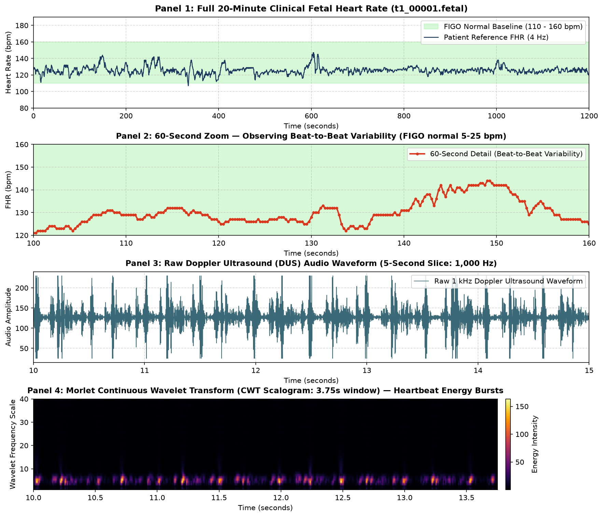

# Autonomous Neuro-Symbolic Agent for Cardiotocography (CTG) Fetal Assessment

[](https://github.com/Prajin-K/agentic-CTG-fetal-assessment)
[](https://www.python.org/)
[](https://pytorch.org/)
[](https://huggingface.co/Qwen/Qwen2.5-1.5B-Instruct)
[](https://www.obgyn.net/)
[](LICENSE)

> [!NOTE]
> **Project Status: Active / Ongoing Research & Development** 🚧  
> This project is actively being developed as part of the Cardiotocography Fetal Well-being Assessment Challenge and towards a journal submission. We are currently implementing the 4-phase neuro-symbolic agent pipeline (Phase 1: EDA & Signal Foundations completed; Phase 2: Morphological Segmentation & Neuro-Symbolic Reasoning in progress).

An autonomous neuro-symbolic AI agent framework for multimodal **Cardiotocography (CTG)** fetal well-being assessment: reconstructing FHR from Doppler ultrasound, segmenting FIGO morphological events, predicting hypoxic risk, and generating grounded, verifiable clinical reports.

---

## 🏛️ System Architecture

```text
+-------------------------------------------------------------------------+
|                         CLINICIAN REQUEST / GOAL                        |
+-------------------------------------------------------------------------+
                                     | (Natural Language Prompt)
                                     v
+-------------------------------------------------------------------------+
|            OFFLINE QWEN2.5-1.5B LLM AGENT (WITH CTG LoRA ADAPTER)       |
|  - Goal Router: Identifies objective (reconstruct | segment | risk | rpt)|
|  - Action Router: Selects next eligible action from strict finite state |
|  - Constrained Decoding: Guided token masks enforce zero hallucinations |
+-------------------------------------------------------------------------+
                                     | (Tool Invocation)
                                     v
+-------------------------------------------------------------------------+
|                     SANDBOXED TOOL EXECUTION ENGINE                     |
|                                                                         |
|  [TASK 1: AutoFHR]         [TASK 2: 1D U-Net]       [TASK 3: Fused CNN] |
|  - Butterworth (50-600Hz)  - 1D Residual U-Net      - Waveform (FHR)    |
|  - Morlet CWT Scalogram    - 3-Channel Probs        - Pattern (Probs)   |
|  - Dilated Causal Conv1D     (Baseline, Accel, Decel)- Concatenation+GAP|
|  - WaveNet Gated Units     - FIGO Event Cleaning    - Sigmoid Risk Score|
|  - Multi-Head Attention      (Duration >= 15s)        (Normal vs Patho) |
+-------------------------------------------------------------------------+
                                     | (Structured Observations)
                                     v
+-------------------------------------------------------------------------+
|                  QUALITY CHECK & ABSTENTION GUARDRAIL                   |
|  - If Task 1 Coverage < 95% -> Flag ABSTAIN = True (Acoustic Dropout)   |
+-------------------------------------------------------------------------+
                                     | (Evidence Synthesis)
                                     v
+-------------------------------------------------------------------------+
|                     GROUNDED FIGO REPORT & AUDITABLE TRACE              |
|  - Structured JSON: Exact numerical metrics & temporal intervals [s, e] |
|  - Clinical Narrative: Formal FIGO assessment text for medical teams    |
|  - Trace File (agent_trace.jsonl): Cryptographic log of all tool steps  |
+-------------------------------------------------------------------------+
```

---

## 🔬 Four Scientific & Architectural Pillars

| Pillar / Dimension | Current Baseline Approach | Our Scientific Novelty |
|---|---|---|
| **1. Neuro-Symbolic Agent Loop** | Outputs a raw risk float (e.g. `0.72`) with no verifiable clinical reasoning. | Bi-directional neuro-symbolic reasoning: every claim in the report is cryptographically grounded in exact time intervals `[start_sec, end_sec]` validated against FIGO criteria. |
| **2. Dynamic Uncertainty Gating** | Static scalar threshold (coverage < 95%) that fails on localized noise bursts. | Multi-scale epistemic uncertainty estimation from CWT scalogram entropy and U-Net dropout variance to actively detect transducer displacement. |
| **3. Cross-Attention Multimodal Fusion** | Naive late concatenation of waveform and segmentation features. | Cross-modal attention mechanism allowing deceleration depth and shape to dynamically attend to heart rate entropy and variability patterns. |
| **4. Hallucination-Free Clinical Reports** | Unconstrained generation prone to metric drift and hallucinations. | Grammar-constrained prefix-tree decoding enforcing strict JSON schemas and 100% adherence to FIGO diagnostic rules. |

---

## 📋 Clinical Foundations (FIGO 2015 Criteria)

* **Baseline FHR:** Normal resting rate is **110 – 160 bpm** (Bradycardia: <110 bpm, Tachycardia: >160 bpm).
* **Variability:** Normal beat-to-beat fluctuations are **5 – 25 bpm** (Reduced: <5 bpm for >50 min, Increased: >25 bpm).
* **Accelerations:** Transient jumps $\ge 15$ bpm lasting $\ge 15$ seconds (reassuring sign of fetal neurological responsiveness).
* **Decelerations:** Transient drops $\ge 15$ bpm lasting $\ge 15$ seconds (early: head compression, variable: cord compression, late: uteroplacental insufficiency / hypoxia).

---

## 📊 Exploratory Data Analysis (EDA)

The repository includes a comprehensive, interactive exploratory analysis notebook under [`notebook/EDA.ipynb`](notebook/EDA.ipynb):

1. **Step 1: Environment & Project Path Setup:** CUDA verification, custom module imports.
2. **Step 2: Inspecting Manifests:** Patient metadata, duration distributions.
3. **Step 3: Loading 1 kHz Doppler Ultrasound Audio:** Waveform statistics, RMS energy, dynamic range.
4. **Step 4: Continuous Wavelet Transform (CWT):** Morlet wavelet scalograms capturing fetal valve acoustic signatures.
5. **Step 5: Loading 4 Hz FHR Ground-Truth:** Binary `.fetal` header parsing and signal validation.
6. **Step 6: Clinical Visualization:** Dual-modality alignment (Doppler audio + scalogram + FHR curve).
7. **Step 7: AutoFHR Reconstruction:** Running Task 1 baseline model and evaluating Mean Absolute Error (MAE) and signal coverage.
8. **Step 8: FIGO Clinical Metrics:** Automated extraction of baseline, variability, accelerations, and decelerations.

A standalone patient inspection script is also available:
```bash
python explore_patient.py
```
Outputs high-resolution clinical multi-panel figures:


---

## 🚀 Quickstart & Installation

### 1. Clone & Setup Environment

```bash
git clone https://github.com/Prajin-K/agentic-CTG-fetal-assessment.git
cd agentic-CTG-fetal-assessment

python -m venv .venv
source .venv/bin/activate  # On Windows: .venv\Scripts\activate

pip install -r requirements.txt accelerate==1.1.1 matplotlib pandas ipykernel
```

### 2. Checkpoints and Model Files

Place pre-trained checkpoints in `checkpoints/` and LoRA adapter under `models/qwen_lora/`:
```text
checkpoints/
|-- task1_autofhr.pt
|-- task2_light_unet.pt
|-- task3_fused_native.pt
`-- task3_fused_flow.pt
models/
`-- qwen_lora/
    |-- adapter_config.json
    `-- adapter_model.safetensors
```

Download the offline Qwen2.5-1.5B base model:
```bash
python -c "from huggingface_hub import snapshot_download; snapshot_download(repo_id='Qwen/Qwen2.5-1.5B-Instruct', revision='989aa7980e4cf806f80c7fef2b1adb7bc71aa306', local_dir='models/qwen')"
```

---

## 🏃 Running the Models

### Run Task Pipelines

```bash
# Task 1: Reconstruct 4 Hz FHR from 1 kHz Doppler Ultrasound
python -m ctg_baseline.run task1 --device cuda --output-root output/task1

# Task 2: Segment Baseline, Accelerations, and Decelerations
python -m ctg_baseline.run task2 --device cuda --output-root output/task2

# Task 3: Predict Fetal Hypoxic Risk Score
python -m ctg_baseline.run task3 --device cuda --output-root output/task3

# Task 4: Complete Autonomous Agent Loop with Grounded Report
python -m ctg_baseline.run task4 --device cuda --llm-model models/qwen --lora-adapter models/qwen_lora --output-root output/task4
```

### Interactive Clinician Dialogue

```bash
python -m ctg_baseline.chat \
  --input data/task1/data/train/wav/t1_00001.wav \
  --input-kind dus \
  --record-id t1_00001 \
  --device cuda \
  --llm-model models/qwen \
  --lora-adapter models/qwen_lora \
  --output output/chat
```

---

## 📄 License & Acknowledgments

This project is licensed under the Apache 2.0 License - see the [LICENSE](LICENSE) file for details.  
Built for the **Cardiotocography Fetal Well-being Assessment Challenge**.
Upstream reference: [wenlizeng/ctg-agent-fetal-assessment-baseline](https://github.com/wenlizeng/ctg-agent-fetal-assessment-baseline).
